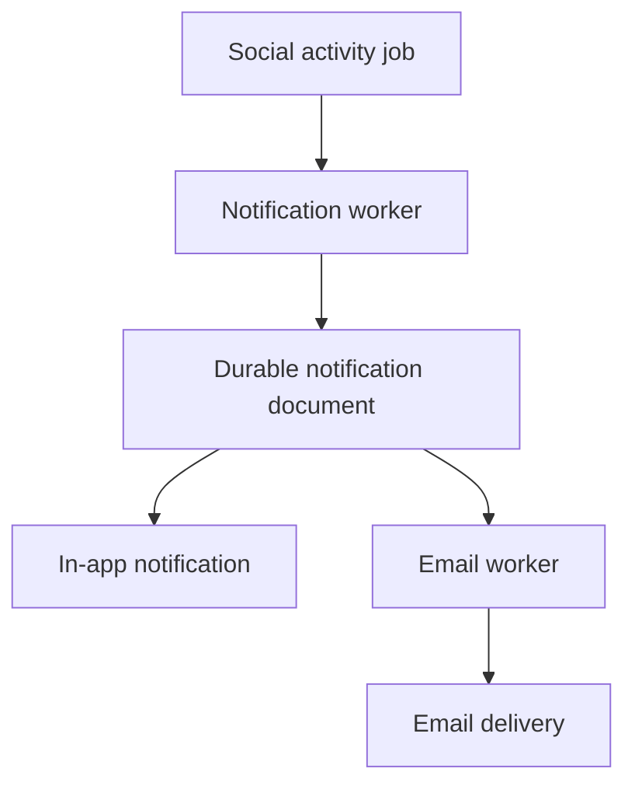

# The Machinery Behind the Feed

An annotated selection from the surviving RealtAsia queue history.

This repository did not begin with a speculative `TODO` and slowly approach a product. Its first commit already contained a working background-processing system. The history that follows is the record of that machinery being separated, operated, migrated and eventually redesigned while the live social network around it kept evolving.

The original commit messages are preserved exactly. Their range extends from proper architectural summaries to a five-commit argument with a shell script.

Dates below are those preserved in the repository history.

---

## 18 February 2013: the “first” commit is already a system

> **[First commit](https://github.com/realtasia/queue-rta/commit/abfb39cc4bfa89ef408dabffb004f98a817e529e)**  
> 12:01

This is plainly the first commit *to this repository*, not the first moment the queue existed.

It arrives with:

- a long-running PHP daemon;
- Unix process forking and signal handling;
- child-process cleanup;
- atomic retrieval of pending MongoDB jobs;
- explicit pending, successful and failed states;
- Amazon SES email batching;
- job processors for social activity;
- separate worker concepts for posts and other background events;
- logging intended to survive a service that never exits.

The queue existed because actions in a social network do not end when an HTTP request returns. A comment may affect subscribers, notification preferences, email summaries and individual feeds. Doing all of that inside the user's request would make the application slow and brittle.

So the application recorded work. The queue performed it elsewhere.

Four hours later:

> **[Final Working copy, future changes on deployment](https://github.com/realtasia/queue-rta/commit/9c55c972964abd08fadf376848b79c19dcdc66dd)**  
> 16:17

This is a wonderfully compact distinction between software and operations. The worker was functioning locally; the next unknowns belonged to deployment.

“Working copy” is also historical evidence worth retaining. This was running machinery, not a dormant design exercise.

---

## 7 March 2013: email and the feed become separate workers

> **[Cleaned out the daemons a bit. renamed controllers to be a little more descriptive. Completed both daemon modules for email and ticker.](https://github.com/realtasia/queue-rta/commit/2ff6c6bbcaaedfb1bebf42d67b571f3fbe9774b8)**

The split is architectural rather than cosmetic.

The email daemon handled the expensive social-notification path: loading the affected object, discovering recipients and interactors, respecting each recipient's notification settings, constructing personalised messages and sending them in batches.

The Ticker daemon maintained each person's feed as stored, per-user records. It understood three kinds of work:

- **new**: distribute a post into the feeds of relevant user and page subscribers;
- **delete**: remove every feed entry referring to the deleted object;
- **update**: refresh entries and enforce changed privacy rules.

A post changing from public to private was therefore a background consistency operation. The worker found the people still entitled to see it and deleted everyone else's copies.

The job claim used MongoDB's `findAndModify` to locate an available job and mark it in progress as one atomic operation. That matters when multiple workers may compete for the same work. The code was not merely polling a collection and hoping two processes did not choose the same document.

The feed was a materialised projection years before most product teams had learnt to call one that.

---

## 13–22 March 2013: tidy the emails, then repair reality

> **[More clean up. Fixed and organized emails](https://github.com/realtasia/queue-rta/commit/752f567e84e179a76378d36d0b24356487eea0e9)**  
> 13 March

Nine days later:

> **[Fixed some bugs with jobs and tickers](https://github.com/realtasia/queue-rta/commit/9346049e99b3ed8c99db67ba0eee5b909364ac12)**  
> 22 March

The second message is vague; the code is not.

The work adjusts how queued jobs become social messages, including acknowledgement mail, beta-join mail and links back to the correct post or recipient settings. The Ticker and email paths were joined by a common fact: both were downstream interpretations of one user action, but they had different delivery and lifecycle requirements.

That is the quiet elegance of this repository. “The queue” was not a bag of unrelated cron jobs. It was the asynchronous half of the application's domain model.

---

## 17 May 2013: extract the queue from the application

> **[Moved out queue files to module. Need to work out a check out](https://github.com/realtasia/queue-rta/commit/fdb81f53b8dd7a864e5a4024894a1aa6aadf2f07)**

Hundreds of lines of queue implementation move out of the application layer and into a dedicated module.

The module boundary gave the API and worker applications a common queue vocabulary without requiring the background service to remain tangled with one deployment. Jobs, processing rules and supporting models could travel together.

“Need to work out a check out” records the less glamorous second half of modularisation: after separating shared code, every environment must reliably obtain the same version of it.

Architecture creates boundaries. Deployment immediately sends an invoice.

---

## 26–28 May 2013: operational visibility and honest debugging

> **[Added new functionality for an admin page for debugging.](https://github.com/realtasia/queue-rta/commit/2b670d3e2701aa6b8266f7cb485380ff3ff10800)**  
> 26 May

The worker gains more explicit job-state handling and visibility around batches and delivery failures. An asynchronous system needs a way to answer questions the web request can no longer answer: Was the job claimed? Did it produce email? Did the provider accept the batch? Was the job marked successful or failed?

Then, shortly after midnight:

> **[Corrected a few bugs in email. A few more to go.](https://github.com/realtasia/queue-rta/commit/0d0ec6ab817f5ad16c184cf95b81598233c91f08)**  
> 28 May

This may be the most trustworthy release note in the repository.

It neither declares victory nor performs despair. Some bugs were corrected. Others remained. The daemon and batch-send path were being changed under observation, which is exactly why the debugging surface had just been added.

---

## 5 June 2013: the IronWorker campaign

> **[Converted to and created IronWorker functionality](https://github.com/realtasia/queue-rta/commit/55bc79c56a43ecd833e9bb240a12b909ca261f82)**  
> 18:26

The local email worker is adapted to submit work to IronWorker, a cloud background-job service. Email batches are split into chunks, posted remotely and monitored by task ID. The repository gains IronWorker configuration, a worker package and payload-handling code.

Then the deployment conversation becomes unusually literal:

> **[testing locally](https://github.com/realtasia/queue-rta/commit/0c3224502f6246023c4351e0e14353cde106bcb4)**  
> 18:28

> **[Forgot to add the sh file](https://github.com/realtasia/queue-rta/commit/25d0ed0757ba5b969d8ff79ac929932b791f51b4)**  
> 18:36

> **[ran exec in sh file](https://github.com/realtasia/queue-rta/commit/3c0a8e1494a0cccaad9c3f5e0cbfc31cfefad990)**  
> 18:40

> **[couldn't run the index.php file](https://github.com/realtasia/queue-rta/commit/44362919d1c3548dd3adf54179f48a948823165f)**  
> 18:41

At 18:40, the shell script says:

```sh
php index.php --uri=email/index
```

One minute later it says:

```sh
php ./index.php --uri=email/index
```

The distinction between a distributed cloud worker and a missing `./` is approximately sixty seconds.

The evening continues:

> **[files not included, trying again](https://github.com/realtasia/queue-rta/commit/88c9f73de71472629ce955d82d923a6c809ca4df)**  
> 23:02

> **[adding single directory](https://github.com/realtasia/queue-rta/commit/3db54b0c068d3fde7421a690f15dd285ef89d692)**  
> 23:56

> **[removing multiple directory includes](https://github.com/realtasia/queue-rta/commit/1ddee9c2226c3e4dc9254a1508f86a00f9dd7513)**  
> 23:57

This is cloud deployment in 2013: conceptually elegant, operationally a hostage negotiation over which files exist inside the worker package.

---

## 6 June 2013: send data, not an object graph

> **[Changing the way emails are constructed and sent](https://github.com/realtasia/queue-rta/commit/cf99f28959e5042b03e5865af5a4506bfe53bbd1)**

The first IronWorker version serialised an entire batch-request object and reconstructed it remotely.

The revised version sends plain email payloads in chunks of ten. The remote worker turns each payload into a provider call. This reduces coupling between the producer and worker, makes the payload inspectable and avoids depending on successful reconstruction of a live SDK object in another process.

In modern terms, the boundary moved from remote object execution towards message passing.

The repository also contains captured payloads and rendered mail output from this work. Those artefacts are untidy by current standards, but they prove the feature was exercised against real application-shaped messages: recipient-specific content, HTML and text bodies, profile images, post links and notification settings.

---

## 7 February 2014: remove Iron, unify notifications

> **[Removed iron-everything. Created notifications worker that creates a collection of dual serving docs for notifications in-app and emails. cleaned up emails](https://github.com/realtasia/queue-rta/commit/7f27484467505748430baafd378316d4642f1432)**

This is the most important commit in the queue history.

IronWorker, its package files and its remote execution path are removed. In their place, background work becomes a two-stage pipeline:



The notification worker consumes a social job, evaluates recipients and preferences, and creates notification documents. Those documents serve two purposes:

1. the application can display them directly as in-app notifications;
2. the email worker can claim notifications awaiting email, render them and mark them as emailed.

That is a strong model because “something happened that this person should know about” becomes the durable fact. In-app display and email are delivery channels derived from it.

The earlier design constructed transient emails directly from jobs. The revised design preserves the notification itself and lets channels consume it independently. It improves inspectability, recovery and consistency between what appears inside the product and what arrives in the inbox.

Removing a fashionable cloud service while improving the domain model is excellent engineering judgement. The dependency was tried, learnt from and discarded when a simpler architecture better matched the product.

---

## 17 February 2014: the logs document the crime scene

> **[Modified notify and removed logs from cache](https://github.com/realtasia/queue-rta/commit/422f0d8bed6abaa381282497804af60b6dbd2fa8)**

The commit removes a substantial volume of captured worker output, including repeated notification processing and PHP memory-exhaustion failures.

There is something almost geological about old committed logs. They preserve successive layers of “In notify”, recipient inspection, summary construction and finally:

> Allowed memory size of 134217728 bytes exhausted

The useful point is not that a long-running PHP worker once exhausted 128 MB. Of course it did. The useful point is that the notification redesign was being run against enough repeated work for lifecycle and memory behaviour to become operational concerns.

The commit also removes abandoned IronWorker and ZeroMQ experiments still lingering as commented code. The replacement design was no longer provisional; the scaffolding could go.

---

## 23 February 2014: the error reporter has an error

> **[Bug in error report](https://github.com/realtasia/queue-rta/commit/6cbb24c1443f2daa1a5276c818da69493234ed51)**

The error path called the debug function with two arguments even though it accepted one. The fix changes provider failures into structured debug values and corrects the call signature.

This is an occupational hazard of infrastructure code: the failure reporter tends to receive its first serious test while something else is already failing.

The commit message wastes no time pretending otherwise.

---

## What the queue actually was

This was more than a mechanism for “doing things later”.

It encoded the asynchronous consequences of the social network:

- social actions became durable jobs;
- workers claimed jobs atomically;
- recipient and interactor data was consolidated before fan-out;
- individual notification preferences controlled delivery;
- email and Ticker processing were separated;
- the Ticker materialised a feed for each user;
- privacy changes propagated by deleting unauthorised feed projections;
- job states made background success and failure observable;
- cloud workers were evaluated when scale and deployment suggested them;
- the design later converged on durable notification documents shared by in-app and email channels.

The final notification flow is recognisably modern. A domain event is processed once into a durable, user-specific notification. Multiple delivery channels then act on that record and track their own state.

The code is of its era: Kohana, MongoDB, PHP daemons, `pcntl_fork`, shell launchers, SES, committed logs and a brief but intense relationship with IronWorker.

The architecture is also of a product that was alive. It contains privacy transitions, subscriber fan-out, per-event preferences, duplicate-work avoidance, batch delivery, operational debugging and migrations prompted by actual use.

And the history contains perhaps the cleanest three-act cloud deployment narrative ever committed:

> Converted to and created IronWorker functionality  
> Forgot to add the sh file  
> couldn't run the index.php file

Followed eight months later by the only ending it truly deserved:

> Removed iron-everything.
